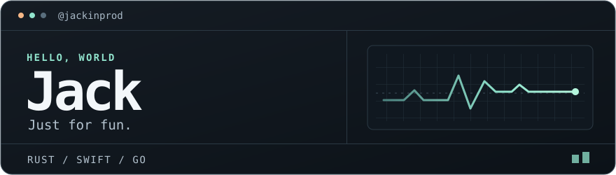

  

I'm Jack, a C++ backend engineer now building AI agents. I'm growing into a full-stack developer so I can take agent ideas from prototype to products people can use.

## Currently building YourAI Harness

A terminal coding agent with a modular Rust runtime. It can read and edit code, run tests, and ask for approval before running shell commands.

[View project](https://github.com/Jack4A/YourAI-Harness) · [See it in action](https://github.com/Jack4A/YourAI-Harness/blob/main/docs/screenshots/conversation.png)
